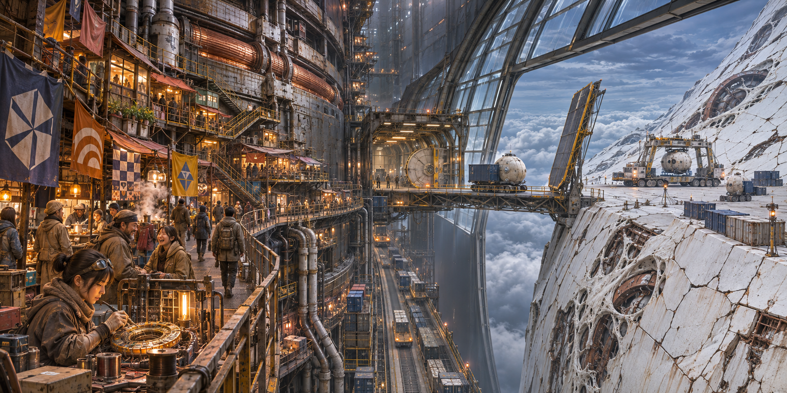
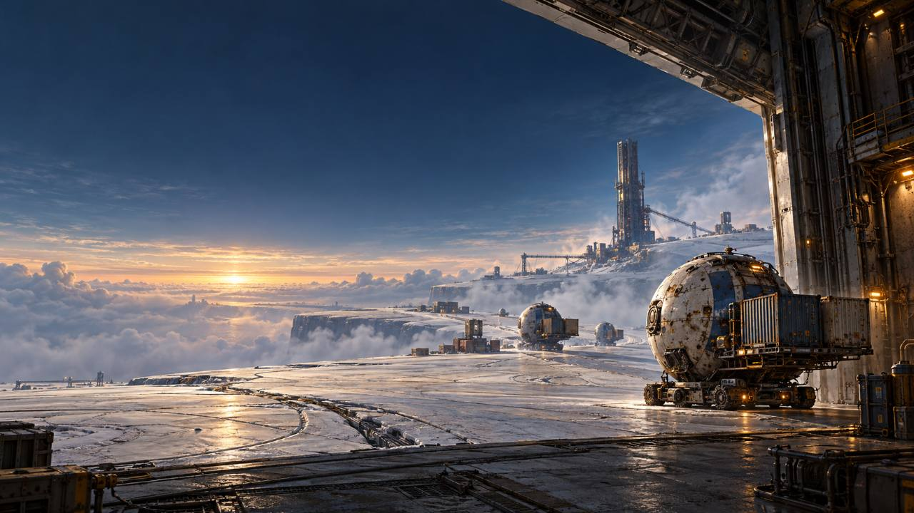
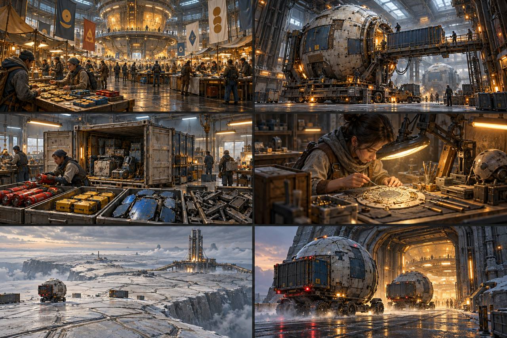
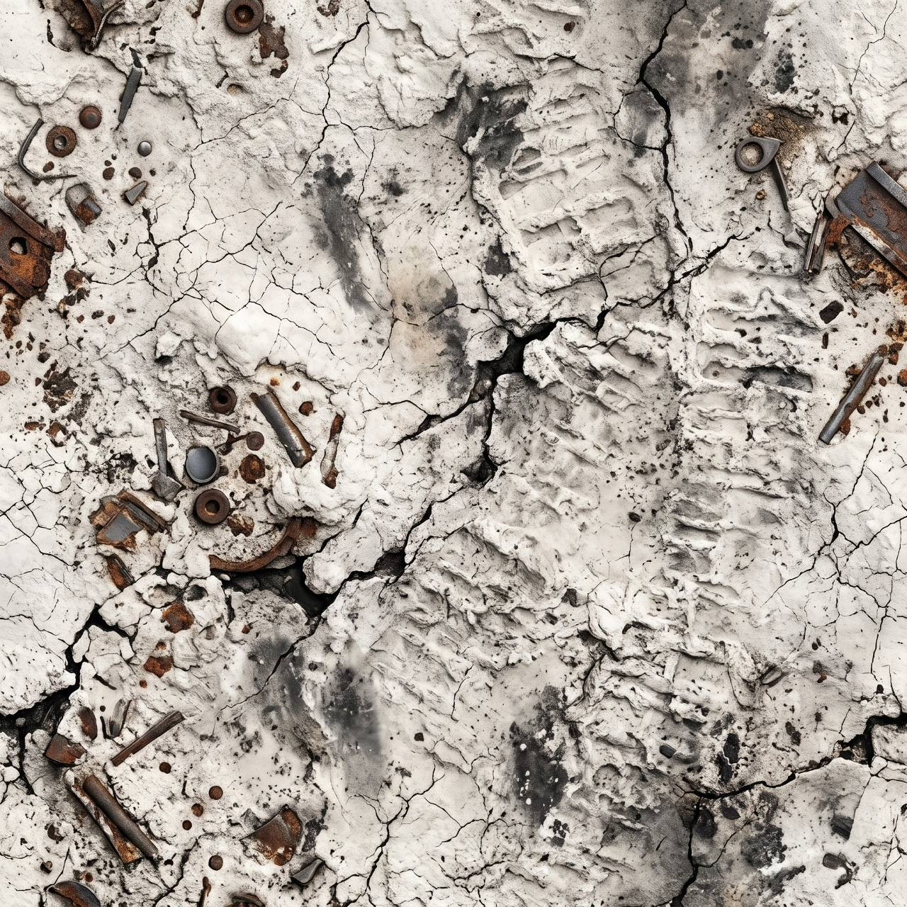

# 世界観アートワーク集

神宮提供の参考画像と、会話で確定した設定に基づくコンセプトアートを原本のまま保管する。
世界観の文章は [PRODUCT_VISION.md §2.1](../PRODUCT_VISION.md#21-舞台改造後の地球と掲示板の成り立ち) と [井戸・外殻・居住区の設定](../WORLD_WELLS_AND_SHELL.md) を参照する。
画像から新たな機体寸法・設備の仕様・ゲームルールを確定しない。

## 砲身を囲む街（2026-11-05 作画、2026-11-07 収録）

神宮との会話で確定した井戸の構造をもとに、ChatGPT が作画。神宮の「いいね。その絵も設定資料集に入れておいて」により収録する。

マスドライバーの砲身外側の管理階段を増改築した街、暖かな市場と回路作業、外殻との間の空間、跳ね橋、球形機体、外殻に取り込まれつつある残骸を描いた。
キャリアや設備の外形・寸法は視覚的な検討であり、確定した設計図ではない。

## 外殻と球形機体（神宮提供・2026-11-04）

雲上の外殻、拠点の出入口、コンテナを運ぶ球形機体。

## コミュニティと探索者の生活（神宮提供・2026-11-04）

市場、格納庫、物資の整備・仕分け、回路作業、外部への出発をまとめたイメージ。

## 地面の質感（神宮提供・2026-11-04）

白い外殻の表面、亀裂、走行跡、混在する金属の残骸の質感。

